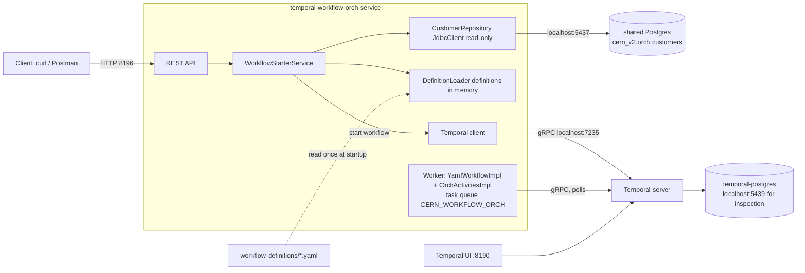

# Phase 1: architecture

## Components



Everything except the app runs in Docker (`docker-compose.yml`). The worker is embedded in the app (`temporal-spring-boot-starter`, auto-discovery of `@WorkflowImpl` / `@ActivityImpl`).
Activities run in the same process and only write log lines.

## Sequence: VOICE customer (C1001)

```mermaid
sequenceDiagram
  participant C as Client
  participant A as API / Starter
  participant D as Postgres (customers)
  participant T as Temporal
  participant W as Worker (workflow + activities)
  C->>A: POST /workflows/start {C1001, OUTREACH_DEFAULT}
  A->>D: SELECT customer C1001
  D-->>A: VOICE
  A->>T: start OUTREACH_DEFAULT-C1001 (definition + customer as input)
  A-->>C: 202 {workflowId, runId}
  T->>W: workflow task
  W->>W: step route (switch VOICE) -> voice-call
  W->>T: schedule executeVoiceCall
  T->>W: activity task: logs "Voice call ..."
  W->>T: start timer 30m (step wait-30-min)
  Note over T,W: workflow RUNNING; the timer lives in Temporal, not in the app
  T->>W: timer fired, workflow task
  W->>T: schedule sendMessage
  T->>W: activity task: logs "Send message ..."
  W->>T: complete workflow (step end)
```

## Sequence: WHATSAPP customer (C1002)

Same as above, except: step `route` goes to `whatsapp-message`, the first activity is `sendMessage` (initial message, no voice call),
then the same 30 minute timer, second `sendMessage`, end.

## Start-all (branch `phase-1-start-all`)

`POST /workflows/start-all` reads every row of `orch.customers` once, then starts `<definition>-<customerId>` for each customer in turn through the same Temporal client call as the single start.
Running customers give `ALREADY_RUNNING` in the result; the request itself still succeeds (202).

## Failure and restart behaviour

| Situation | What happens |
|---|---|
| App restarts during the 30 minute delay | The timer is in Temporal. The workflow is replayed when a worker comes back (replay logs nothing), the timer fires on time or late, the follow-up is sent. Verified manually: a VOICE workflow started, app killed, app restarted, workflow COMPLETED with the follow-up sent. |
| An activity throws | Temporal retries (start-to-close 30s, max 3 attempts); `ACT_FAILED` is logged per attempt; after the last attempt the activity, and so the workflow, fails and `WF_FAILED` is logged. Not exercised by the log-only activities. |
| App Postgres down at start time | `CustomerRepository` throws; the start request errors (expected HTTP 500 from Spring's default handling; not exercised) and no workflow is started. Running workflows are unaffected (they never touch the DB). |
| Temporal down at start time | The start call fails; the request errors (no workflow). |
| Same customer started twice | Second start returns 409 while the first is running. |
| Bad channel value in the DB | The table's CHECK constraint prevents it; if a definition had no matching case, the workflow fails with `No case for ...`. |
| YAML broken | The app refuses to start, naming the file and problems. |

## Runtime facts

| Item | Value |
|---|---|
| HTTP | 8196 |
| Temporal gRPC / UI (host) | 7235 / 8190 (inside Docker: 7233 / 8080) |
| Namespace / task queue | `default` / `CERN_WORKFLOW_ORCH` |
| App DB | `cern_v2`, schema `orch`, table `orch.customers` (host port 5437, shared Postgres of the parent folder's compose) |
| Workflow id | `<definition>-<customerId>` |
| Containers | `cern-v2-orch-temporal-postgres`, `cern-v2-orch-temporal`, `cern-v2-orch-temporal-ui` (the app Postgres `cern-v2-postgres` is in the parent folder's compose) |

## Where each latency is measured

| Log field | Measured | Clock |
|---|---|---|
| `lookupMs` | around `CustomerRepository.findById` | `System.nanoTime` in the starter |
| `startMs` | around `WorkflowClient.start` | `System.nanoTime` in the starter |
| API `totalMs` | whole `WorkflowStarterService.start` | `System.nanoTime` |
| `startLagMs` | first workflow task time minus the run start time in workflow info | workflow time |
| `scheduleToStartMs` | activity scheduled timestamp (from `ActivityInfo`) to activity body start | wall clock |
| `execMs` | inside the activity body | `System.nanoTime` |
| `stepMs` | step enter to step exit | workflow time (includes the sleep for `delay`) |
| workflow `totalMs` | first task to the end step | workflow time |

Wall-clock fields (`scheduleToStartMs`, `startLagMs`) compare timestamps taken by the Temporal server and by this JVM; on one machine that is fine.

## Deliberately not in Phase 1

Result-returning activities, `switch` on results, `delay` from a result, `${...}` params, hot reload and runtime YAML editing (Phase 2);
customer replies, signals and `await` (Phase 3); any real voice or WhatsApp integration; DB writes; schema creation by the app; load tests (separate effort); Kafka.
