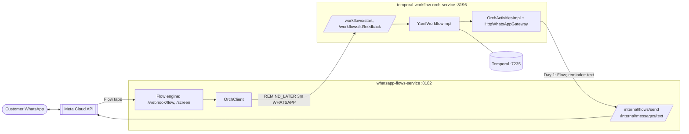

# Phase 3 - Architecture: WhatsApp integration

Two projects under `/home/anujg/projects/cern/`, started together:

## One reminder, end to end

1. `POST /workflows/start {customerId, definition}` on the orchestrator. Day 0.
2. Day 1 (dev: 3 minutes later, prod: next day 10:00 IST): `first-contact` runs. The customer's DB channel is `WHATSAPP`, and the step has `flow: AMB_REMINDER_RADIO`, so `sendMessage` calls `POST whatsapp-flows-service/internal/flows/send {waId, flowKey, bodyText, customerId, workflowId}`.
3. The flows service mints a `flow_token`, stores a `flow_session` row with `workflow_id` and `customer_id`, and sends the Flow message through the Cloud API.
4. The customer taps through the Flow and picks "Within 3 days". At the `SCHEDULE_FUNDS_REMINDER` node the flows service maps the option to a duration (`reminder.timing.*`, `3m` dev / `3d` prod) and calls `POST orchestrator/workflows/{workflowId}/feedback {type: REMIND_LATER, remindAfter, channel: WHATSAPP}`.
5. The workflow's `await-first` receives the signal, goes to `wait-reminder` (delay from `reminder.after`), then `reminder-contact` on `WHATSAPP` (no `flow`), which calls `POST /internal/messages/text`: the customer gets the reminder as a WhatsApp text.
6. An unanswered reminder repeats (max 2), then one final SMS (log only); the campaign window still ends on Day 15.

## Failure behaviour

- WhatsApp refuses a message (for example free text or a Flow outside the 24 hour window, bad number, bad token): the flows service answers 502 with Meta's body; the orchestrator activity logs `event=ACT_WHATSAPP_FAILED` and the workflow continues (no retry).
- The orchestrator unreachable when the customer answers the Flow: the flows service logs the error and the Flow still completes, without a reminder.
- A session started outside the orchestrator (`POST /trigger`, Meta's preview tool) has no `workflow_id`: no reminder is sent.

## Ports and names

| | Orchestrator | Flows |
|---|---|---|
| HTTP | 8196 | 8182 |
| Postgres | shared, 5437, database `cern_v2`, schema `orch` | shared, 5437, database `cern_v2`, schema `flow_engine` |
| Temporal gRPC / UI / its Postgres | 7235 / 8190 / 5439 | - |
| Compose | `cern-v2-orch` (Temporal, UI, Temporal's Postgres) | none: uses the shared `cern-v2-shared` compose in the parent folder (`cern-v2-postgres`) |
