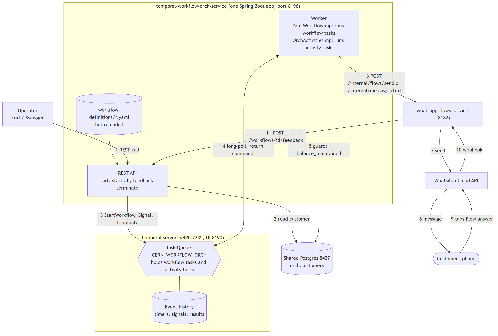
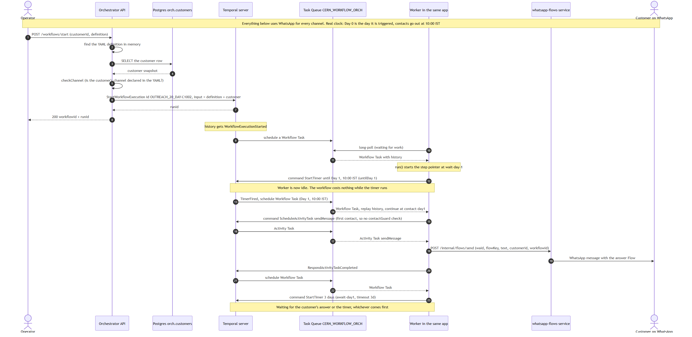
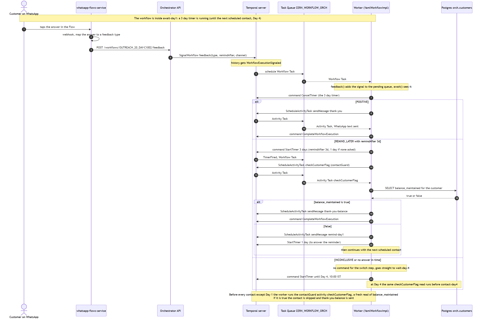
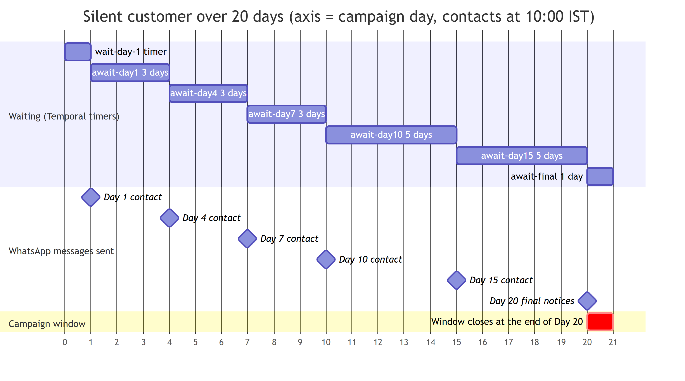
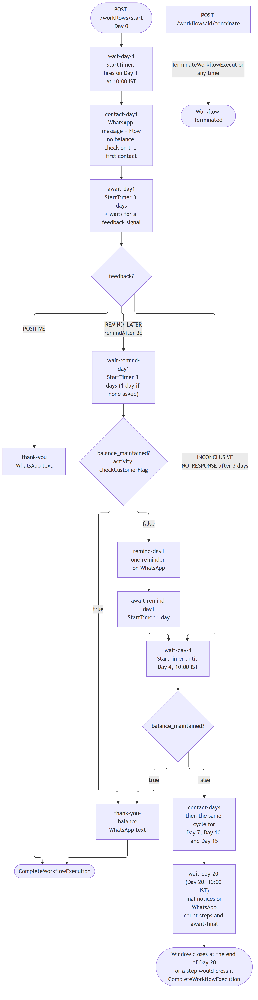

# Temporal Concepts and Internals: temporal-workflow-orch-service

| | |
|---|---|
| **Service** | temporal-workflow-orch-service |
| **Document type** | Technical overview |
| **Date** | 26 October 2026 |

## Summary

- Temporal is a workflow engine. It runs long-lived business processes as ordinary code and keeps their state durable, so a process survives crashes, restarts and deployments and can wait for days without using any resources.
- This service starts one Temporal workflow per customer. Each workflow is a multi-day customer outreach campaign (for example the 20 day campaign `OUTREACH_20_DAY`), defined in a YAML file and run by one generic workflow class.
- The Temporal server does not run application code. It stores each workflow's history and timers and hands out tasks. The application's Worker runs the code and reports back what it decided.
- Every interaction with the outside world (sending a message, reading the database) is an *activity*. Waiting is a durable *timer*. Customer answers arrive as *signals*.
- Sections 1 to 6 explain Temporal in general. Section 7 maps those ideas to this service. Sections 8 to 11 walk through the service's sequence, timeline and decision diagrams. Section 12 shows how to inspect a running workflow.

## Contents

1. What Temporal provides
2. Architecture overview
3. Core concepts
4. Inside the Temporal server
5. How a workflow executes
6. Failure behaviour
7. How the service uses Temporal
8. Walkthrough: starting a workflow
9. Walkthrough: customer feedback and commands
10. Walkthrough: campaign timeline
11. Walkthrough: decision flow
12. Inspecting a workflow

## 1. What Temporal provides

Temporal runs long-lived business processes ("workflows") as ordinary code and makes them **durable**: the process survives crashes, restarts and deployments, and can wait for days or months without holding a thread, a connection or any memory.

- **Durable timers.** A workflow can sleep for 20 days. The timer lives in Temporal's database, not in the application.
- **Automatic retries.** Calls to the outside world (HTTP, database, SMS) are retried by Temporal with a configurable retry policy.
- **Exact history.** Every decision and result is recorded, so what happened to any one customer can be inspected, and the workflow can be rebuilt after a crash.
- **External events.** A running workflow can receive messages (signals), for example "the customer answered".

The trade-off: workflow code must be **deterministic** (see section 5), and everything that touches the outside world goes through **activities**.

## 2. Architecture overview

*Figure 1: System architecture, including the services inside the Temporal server.*

Figure 1 shows the components and the order of a typical request:

| Box | What it is |
|---|---|
| **REST API** and **Worker** (inside the Spring Boot app) | Application code (this service). The API is a *Temporal client*: it starts, signals and terminates workflows. The Worker runs the workflow and activity code. Both live in one process here, but they could be separate apps. |
| **Temporal server** | Not application code. It stores the state of every workflow and hands out work. It never runs application code. |
| **Temporal's own Postgres** | The server's database. Separate from the app's Postgres (`orch.customers`), on purpose. |
| **Shared Postgres, whatsapp-flows-service, WhatsApp** | The outside world. Only *activities* talk to it. |

Numbered arrows in Figure 1: (1) the operator calls the API; (2) the API reads the customer; (3) the API asks Temporal to start, signal or terminate a workflow; (4) the Worker long-polls Temporal for tasks and returns the results; (5) and (6) the Worker's activities read the `balance_maintained` flag and send the message; (7) to (10) the message reaches the customer and the answer comes back; (11) the answer becomes a signal to the workflow.

## 3. Core concepts

| Concept | Meaning |
|---|---|
| **Namespace** | A logical partition of the server (`default` here). Workflow IDs are unique within one. |
| **Workflow** | A function that describes the process. It has a **workflow ID** (here `<definition>-<customerId>`, for example `OUTREACH_20_DAY-C1002`) and a **run ID** per execution. |
| **Activity** | A function that does one side effect (call an API, read a database). May fail, is retried, can take time. |
| **Worker** | A process that hosts workflow and activity code and polls a task queue. Capacity scales by running more of them. |
| **Task Queue** | A named queue (`CERN_WORKFLOW_ORCH`) that connects the server to workers. |
| **Event history** | The append-only log of everything that happened to one workflow. It is the workflow's state. |
| **Command** | What the worker tells the server it wants (`StartTimer`, `ScheduleActivityTask`, `CompleteWorkflowExecution`). |
| **Event** | What the server records after a command or an outside action (`TimerStarted`, `TimerFired`, `ActivityTaskCompleted`, `WorkflowExecutionSignaled`). |
| **Workflow Task** | "Here is the history, decide what happens next." Sent to a worker; the worker answers with commands. |
| **Activity Task** | "Run this activity." Sent to a worker; the worker answers with a result or a failure. |
| **Timer** | A durable wake-up call. |
| **Signal** | A message sent to a running workflow from outside. Asynchronous, recorded in the history. |

## 4. Inside the Temporal server

The server is a few cooperating services (one process in a small setup such as this project's `docker-compose.yml`, separate scalable services in production).

| Service | Job |
|---|---|
| **Frontend** | The gRPC entry point (port 7235 here). Checks and routes every request: start, signal, terminate, poll. Clients and workers only ever talk to this one. |
| **History** | Owns each workflow. Appends events to its history, keeps its timers, decides when a new workflow task or activity task is due. Workflows are spread over a fixed number of **shards** (chosen when the cluster is created), by a hash of the workflow ID. |
| **Matching** | Owns the **task queues**. Holds tasks until a worker long-polls for them, then hands one over. If no worker is waiting, tasks wait in the queue (and are persisted), so nothing is lost while workers are down. |
| **Worker (internal)** | Runs the server's own housekeeping workflows. Not related to the application's Worker. |
| **Persistence** | A database (Postgres here; also Cassandra or MySQL). Holds histories, timers, queued tasks and the visibility records the UI lists. |
| **Web UI** | Browse workflows and their histories (http://localhost:8190). |

Typical hop for one step: *Frontend* receives a signal, *History* appends the event and decides a workflow task is needed, *Matching* queues it, a worker polls it, the worker's commands go back through *Frontend* to *History*.

## 5. How a workflow executes

1. **Start.** A client calls `StartWorkflowExecution` with the input. History records `WorkflowExecutionStarted` and a workflow task is queued.
2. **Workflow task.** A worker polls, receives the history, and runs the workflow code **from the beginning**, feeding it the recorded events (this is **replay**). Where the code reaches something new, it issues a command instead of doing it again.
3. **Commands become events.** The worker returns its commands (`StartTimer`, `ScheduleActivityTask` ...). History records them. If the workflow is now only waiting, the worker is free: **a waiting workflow costs no worker resources**.
4. **Something happens** (timer fires, activity completes, signal arrives). History records the event and queues a new workflow task. Go to step 2.
5. **Finish.** The code returns, the worker sends `CompleteWorkflowExecution`, the history is closed.

Replaying a long history on every task would be slow, so workers keep recently used workflows in a cache ("sticky" execution) and the server sends the next task, with only the new events, to the same worker. After a restart or a cache miss, the worker replays the whole history. This is why nothing is lost when a worker dies.

### Determinism: the rule that makes replay work

Replay only works if the workflow code makes the same decisions every time it sees the same history. So **workflow code must not**: call HTTP or databases, read the system clock, generate random numbers, start threads, or use mutable global state. It uses Temporal's replacements instead (`Workflow.sleep`, `Workflow.await`, `Workflow.currentTimeMillis`, activities for everything else). Changing workflow code while old executions are still running needs versioning (`Workflow.getVersion`), otherwise their replay can fail.

### Activities, retries and timeouts

- An activity may run **more than once** (a retry, or a worker that died after doing the work but before reporting it). Activities should therefore be idempotent where it matters.
- Each call has timeouts (for example *start-to-close*: how long one attempt may run) and a **retry policy** (initial wait, backoff, maximum wait, maximum attempts, errors never to retry). Temporal's default is to retry forever with growing pauses; a project can limit it.

### Limits

A single history is capped at about 50,000 events or 50 MB. Workflows that could run for ever "continue as new" (start a fresh run with carried-over state). Short, bounded workflows such as a 20 day campaign stay far below it.

## 6. Failure behaviour

| Failure | Result |
|---|---|
| Worker crashes mid-task | The task times out and goes to another worker, which replays the history and carries on. |
| All workers are down | Tasks wait in the task queue; timers still fire as events. Work resumes when a worker returns. |
| Temporal server restarts | State is in its database; nothing is lost. Clients and workers reconnect. |
| Temporal's database is down | The server cannot make progress; running code in workers waits and reconnects. |
| An activity throws | Retried by the policy. When attempts run out, the activity fails and the workflow code decides (catch it, fail, take another branch). |
| The app's own database is down | Only activities that use it fail and retry; the workflow is untouched. |

## 7. How the service uses Temporal

| Idea | In this project |
|---|---|
| The workflow | One generic interface, `YamlWorkflow` (`temporal/workflow`), implemented by `YamlWorkflowImpl`. The **YAML definition is the workflow's input** (`run(WorkflowDefinition, WorkflowInput)`), so the script travels with the run: a running workflow keeps the definition it started with, and editing a YAML file only affects workflows started afterwards. |
| The step pointer | `YamlWorkflowImpl` walks the `steps` of the definition one at a time. It caps step transitions per run at 500 (`MAX_TRANSITIONS`). |
| Waiting | `delay` steps use `Workflow.sleep` until the right day and hour; `await-feedback` steps use `Workflow.await` with a timeout. Both are durable timers. |
| Signals | `feedback(FeedbackSignal)` is the one signal method. The REST endpoint `POST /workflows/{id}/feedback` sends it. |
| Activities | `OrchActivities` / `OrchActivitiesImpl` (`temporal/activity`): `sendMessage`, `executeVoiceCall` and the guard read `checkCustomerFlag`. |
| Retry policies | Contact activities: 30 s per attempt, at most 3 attempts. The guard read (`contactGuard`): 30 s per attempt, retried with growing pauses (2 s up to 1 minute) with no attempt limit, except `BadGuardColumn`, which is never retried. So a database outage can neither end a campaign nor let a reminder through unchecked. |
| The client | `WorkflowStarterService`, `FeedbackService`, `TerminationService` (`service`) call Temporal through `WorkflowClient`. |
| Task queue | `CERN_WORKFLOW_ORCH` (`OrchTaskQueue`). |
| Server stack | `docker-compose.yml`: Temporal (gRPC 7235), its own Postgres (5439, inspection only), the UI (8190). |
| Determinism in practice | Workflow code never calls the database or WhatsApp directly. The customer snapshot comes in as input, the fresh `balance_maintained` value comes from an activity, the message goes out from an activity. |

## 8. Walkthrough: starting a workflow

*Figure 2: Sequence of starting a workflow, from the REST call to the first message.*

The numbers below refer to the numbered steps in Figure 2.

1. The API finds the definition in memory, reads the customer row (steps 3 and 4) and checks that the customer's channel is declared in the YAML. All of this is plain application code, before Temporal is involved.
2. Step 6, `StartWorkflowExecution`, with the workflow ID `OUTREACH_20_DAY-C1002` and the definition plus customer as input. The workflow ID also guards against duplicates: starting the same ID twice while it runs is refused.
3. Steps 9 to 11: History records `WorkflowExecutionStarted`, Matching queues a workflow task, the Worker's long poll receives it with the history.
4. Step 12: the worker runs `run()`, reaches `wait-day-1`, and answers with a `StartTimer` command (until Day 1, 10:00 IST). The worker is now idle; nothing runs in the app until the timer fires.
5. Steps 13 and 14: the timer fires, a new workflow task replays the history and continues at `contact-day1`. It is the first contact, so no `contactGuard` check.
6. Steps 15 to 20: `ScheduleActivityTask sendMessage`. The activity task goes to the worker, which calls whatsapp-flows-service, then reports `RespondActivityTaskCompleted`.
7. Steps 21 to 23: another workflow task, and the workflow starts the 3 day timer of `await-day1` and waits for either the answer or the timer.

## 9. Walkthrough: customer feedback and commands

*Figure 3: Sequence of a customer answer arriving as a signal, and the three branches that follow.*

- The customer's answer reaches the API, which sends a **signal** (`SignalWorkflow`). History records `WorkflowExecutionSignaled`. This works however long the workflow has been asleep.
- The next workflow task delivers the signal; the workflow sees it in `await-feedback` and issues `CancelTimer` for the 3 day wait.
- Then the branch depends on the answer. POSITIVE sends the thank-you and completes. REMIND_LATER waits the requested time (3 days here), then runs the guard read: an activity that reads `balance_maintained` from Postgres. If it is true, `thank-you-balance` is sent and the workflow ends; if false, the reminder goes out and the workflow gets one day to hear back. INCONCLUSIVE or no answer goes on to Day 4, where the same guard runs before `contact-day4`.
- The guard is an activity, not workflow code, precisely because of the determinism rule: a database read is a side effect and its result must be recorded in the history.

## 10. Walkthrough: campaign timeline

*Figure 4: Timeline of a customer who never answers. The axis counts campaign days; Day 0 is the day the workflow is triggered.*

Figure 4 shows the 20 day `OUTREACH_20_DAY` campaign for a customer who never answers. Contacts go out at 10:00 IST (`sendHour`) on the scheduled days.

| In the chart | What it is in Temporal |
|---|---|
| `wait-day-1 timer` (Day 0 to Day 1) | A timer started when the workflow begins. When it fires, the Day 1 contact is made. |
| `await-day1`, `await-day4`, `await-day7` (3 days each) | The wait for a feedback signal, with a 3 day timeout that ends at the next scheduled contact. |
| `await-day10`, `await-day15` (5 days each) | The same wait, with a 5 day timeout. |
| Contact milestones (Day 1, 4, 7, 10, 15) and the Day 20 final notices | Each one is an activity that sends a message. |
| `await-final` (Day 20 to the end of Day 20) | The last wait. It is cut at the end of Day 20, and the campaign then ends normally. |
| Window closes at the end of Day 20 | The campaign window (`maxDays: 20`). A step that would cross it is dropped and the workflow completes. |

Every bar in the "Waiting" section is a Temporal timer; every milestone is an activity. Between them the workflow is only a few rows in Temporal's database and costs the application nothing.

For demonstrations the Spring profile `dev` shortens one campaign day to 3 minutes (`orch.timing.day-length`), so the whole run takes about an hour. Only the length of the timers changes; the steps, the order and the history are the same as in production.

## 11. Walkthrough: decision flow

*Figure 5: Decision flow of the workflow steps, with the Temporal timers, signal and activities involved.*

The same workflow seen as a flowchart of the YAML steps: each rectangle is a step, each diamond a `switch` or the guard. In Temporal terms:

- **Timers**: `wait-day-*`, `wait-remind-*` and the timeouts of the `await-*` steps.
- **Signal**: the `feedback?` diamond. The feedback value decides which branch the workflow code follows.
- **Activities**: every `contact-*`, `remind-*`, `thank-you*` and `final-notice-*` step, and each `balance_maintained?` check.
- **No command at all**: a `switch` costs nothing, the code only moves the step pointer.
- **Termination**: the dotted path at the top right. `POST /workflows/{id}/terminate` becomes `TerminateWorkflowExecution`, which ends the run at any time, whatever it is waiting for.

## 12. Inspecting a workflow

In the local development stack the Temporal UI is at http://localhost:8190. Select the namespace `default` and search for the workflow ID (for example `OUTREACH_20_DAY-C1002`). The event history lists, in order: `WorkflowExecutionStarted`, `TimerStarted` / `TimerFired`, `ActivityTaskScheduled` / `ActivityTaskCompleted`, `WorkflowExecutionSignaled`, and finally `WorkflowExecutionCompleted` (or `Terminated`). Reading this list is the quickest way to answer "what happened to this customer, and what is it waiting for now".

Reference: Temporal documentation, https://docs.temporal.io
